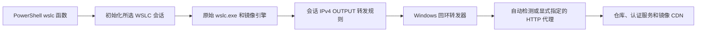

# WSLC Local Proxy

让 PowerShell 中的 `wslc pull` 使用本机 HTTP 代理、Docker Hub 镜像源和按仓库配置的镜像源映射。默认自动检测代理，镜像源和映射通过命令设置。

这是针对 **WSLC 3.0.5 / Docker 25.0.3** 实测的兼容方案，代理功能也在 3.0.3 上验证过。镜像由原来的 WSLC 引擎下载，不经过 Docker Desktop，也不需要导出、导入镜像。PowerShell 包装函数会在相关命令执行前恢复镜像源和会话内转发规则，引擎进程和事件连接保持运行。

## 环境

- Windows，已安装支持容器功能的 WSLC；镜像源功能实测版本为 3.0.5。
- Windows PowerShell 5.1 或 PowerShell 7。
- 使用默认自动代理时，需要一个支持 **HTTP CONNECT** 的代理入口。镜像源可在关闭代理后独立使用。
- 从源码构建需要 Go 1.27 或更新版本；只有 Go 标准库依赖。

## 下载和安装

从 [最新 Release](https://github.com/gongshuiwen/wslc-local-proxy/releases/latest) 下载适合系统架构的安装包：

- 普通 Intel / AMD 64 位 Windows：`wslc-local-proxy-<版本>-windows-amd64.zip`。
- ARM64 Windows：`wslc-local-proxy-<版本>-windows-arm64.zip`。

先安装支持容器功能的 WSLC，确保 PowerShell 中能找到 `wslc.exe`。将 ZIP **完整解压**到任意目录，双击 `Install.cmd` 即可安装到当前用户，无需管理员权限或 Go。首次安装默认自动检测本机代理，升级保留已保存的配置。安装后重开 PowerShell，再执行：

```powershell
Get-WslcProxyConfig
wslc pull lscr.io/linuxserver/webtop:latest
```

也可以在解压目录中通过命令行安装，参数与源码安装相同：

```powershell
.\Install.cmd
.\Install.cmd -ProxyUrl http://127.0.0.1:10808
```

Release 同时提供 `SHA256SUMS.txt`；可用 `Get-FileHash .\下载的安装包.zip -Algorithm SHA256` 核对。GitHub 自动生成的 `Source code` 压缩包不含编译好的程序；需要直接安装时请选择上述 Windows ZIP 附件。

安装前检查 WSLC、程序架构和程序校验值。安装与卸载共用当前用户的跨进程锁；不变的文件和 profile 不重写、不增加备份。ANSI、UTF-8 和带 BOM 的 Unicode profile 会保留原有文本，修改后的 profile 使用兼容 PowerShell 5.1 的 UTF-8 BOM 编码，原始字节另存到 `backups`。

文件更新先暂存，再逐个原子替换；短暂共享冲突最多重试约 1 秒，已产生恢复备份的部分替换不重试。捕获到失败时恢复已修改的文件，旧转发器继续运行。成功升级程序后才停止旧转发器，下次相关 WSLC 命令会重新启动它；升级前应结束正在进行的镜像传输。若恢复也被文件占用等原因阻止，会报错并保留 `.rollback` 文件供恢复。强制结束安装进程或断电不属于完整安装回滚的保证范围。

自定义的 `-ProfileRoot` 会记入安装目录的 `install.json`，后续升级和卸载可自动读取。从 v0.1.0 的自定义 profile 路径升级时，首次仍需传入原来的 `-ProfileRoot` 参数。

## 从源码构建和安装

```powershell
.\Build.ps1

# 自动检测代理
.\Install-WslcProxy.ps1 -Auto

# 或明确指定地址；裸 host:port 也可以
.\Install-WslcProxy.ps1 -ProxyUrl http://127.0.0.1:7890
```

安装目录默认为 `%LOCALAPPDATA%\wslc-local-proxy`。安装脚本会在 PowerShell 7 和 Windows PowerShell 5.1 的用户级 `profile.ps1` 中加入加载段，已有文件先备份到安装目录的 `backups` 文件夹。

新开的 PowerShell 会自动加载。已经打开的窗口执行一次：

```powershell
. "$env:LOCALAPPDATA\wslc-local-proxy\profile.ps1"
Get-WslcProxyConfig
wslc pull lscr.io/linuxserver/webtop:latest
```

更新已有安装时，不带 `-Auto` 或 `-ProxyUrl` 会保留已保存的配置：

```powershell
.\Build.ps1
.\Install-WslcProxy.ps1
```

本地旧版二进制不会代替新的构建结果；仓库中的安装脚本要求先生成 `dist\wslc-local-proxy.exe`。

## 代理选择顺序

| 优先级 | 来源 | 作用范围 |
| --- | --- | --- |
| 1 | `Enable-WslcProxy -ProxyUrl ...` | 当前 PowerShell 窗口的临时覆盖 |
| 2 | 安装参数或 `Set-WslcProxy` 保存的地址 | 用户配置文件 `config.json` |
| 3 | Windows 当前启用的用户级静态代理 | 读取 Internet Settings 中的 `ProxyEnable`、`ProxyServer` |
| 4 | `HTTPS_PROXY`、`HTTP_PROXY`、`ALL_PROXY` | Windows 没有启用静态代理时，按此顺序查找环境变量 |

Windows 的 `https=host:port;http=host:port` 格式优先选 `https` 条目，其次选 `http`。这里的键表示目标请求的协议，选择后的代理入口仍按 HTTP CONNECT 使用。

自动模式会在下次相关命令执行前重新读取 Windows 设置；不会把首次检测到的 `10808` 等端口固定在脚本中。没有找到可用地址时，命令会报告如何显式配置，不会悄悄选择一个默认端口。

支持 `http://host:port`、`host:port`、`http://[::1]:port`。当前不支持 SOCKS-only 入口、代理认证、HTTPS-to-proxy、PAC/WPAD 展开或 Windows 按网站绕过列表；有这些配置时，请选择可用的 HTTP CONNECT 入口并显式传入。

## 修改和查看配置

```powershell
# 保存地址，后续窗口也使用它
Set-WslcProxy -ProxyUrl http://127.0.0.1:7890

# 删除显式覆盖，重新自动检测
Set-WslcProxy -Auto

# 查看最终地址和来源
Get-WslcProxyConfig

# 临时使用另一个代理，只影响本窗口的选择
Enable-WslcProxy -ProxyUrl http://127.0.0.1:8080

# 查看会话规则计数和最近的 CONNECT 目标
Get-WslcProxyStatus

# 移除默认会话的规则，并关闭本窗口的自动初始化
Disable-WslcProxy
Enable-WslcProxy
```

`Set-WslcProxy` 保存的改变在下一次 `pull/push/build/run/create` 时应用。切换上游地址会重启共享的辅助转发器，正在经它传输的连接会关闭；请在当前拉取完成后切换。引擎进程不需要重启。

## Docker Hub 镜像源

```powershell
# 地址需替换为实际的 Docker Hub 镜像源；按顺序尝试，重复地址会去除
Set-WslcRegistryMirrors -Mirrors https://mirror.example.com,https://backup.example.com

# 查看本机保存值 Configured、当前会话生效值 Effective 和是否待同步 Pending
Get-WslcRegistryMirrors

# 清空保存值和当前会话的镜像源；保留自动代理配置
Clear-WslcRegistryMirrors
```

三个命令都支持 `-Session <名称或ID>`，例如 `Get-WslcRegistryMirrors -Session 1`。设置保存在同一份 `config.json`，对后续相关命令使用的会话生效；`-Session` 指定本次立即查看或应用的会话。其他已运行会话在下次执行包装命令时同步。

首次安装不预设镜像源，也不接管已有引擎镜像源。调用设置或清空命令后，本工具管理该列表；空数组 `[]` 表示明确禁用镜像源。修改代理模式、地址和升级安装均保留镜像源列表。

设置命令先校验地址并应用到引擎，成功后才保存。应用时合并 `/etc/docker/daemon.json`，保留 `features.cdi` 等其他字段，执行 `dockerd --validate`，原子替换后发送 `SIGHUP`，再查询引擎确认生效。应用失败时恢复原引擎配置；会话重建后，在下次相关命令前重新应用。不重启引擎，也不修改 Go 转发器。

本节的引擎镜像源只影响 **Docker Hub 拉取**（如 `alpine`、`docker.io/library/alpine`）。`lscr.io`、`ghcr.io` 等仓库可使用下一节的映射功能。独立 BuildKit builder 的镜像源需单独配置。地址支持根路径的 HTTP/HTTPS URL，不接受账号密码、路径、查询或片段；HTTPS 证书照常验证，不自动添加 `insecure-registries`。

镜像源与代理开关独立：`Disable-WslcProxy` 后仍会应用镜像源，`Enable-WslcProxy` 恢复代理。使用代理时，镜像源请求也遵循下述网络转发范围。

参考：[Docker Hub 镜像源](https://docs.docker.com/docker-hub/image-library/mirror/)、[引擎配置热重载](https://docs.docker.com/reference/cli/dockerd/#configuration-reload-behavior)、[BuildKit 镜像源](https://docs.docker.com/build/buildkit/configure/#registry-mirror)。

## 按仓库映射镜像源

```powershell
# 将占位地址替换为实际的镜像站；填写镜像引用前缀，不带 http(s)://
Set-WslcRegistryMapping -Registry ghcr.io -Mirrors mirror.example.com/ghcr,backup.example.com/ghcr
Set-WslcRegistryMapping -Registry lscr.io -Mirrors lscr-mirror.example.com
Get-WslcRegistryMapping
Get-WslcRegistryMapping -Registry ghcr.io

# ghcr.io/org/image:tag -> mirror.example.com/ghcr/org/image:tag
wslc pull ghcr.io/org/image:tag
wslc run --rm ghcr.io/org/image:tag

Clear-WslcRegistryMapping -Registry ghcr.io  # 只清除此仓库
Clear-WslcRegistryMapping                   # 清空全部映射
```

映射保存在同一份 `config.json` 的 `registryMappings` 对象中，键为原仓库的 `host[:port]`，值为有序的镜像引用前缀数组。支持 `ghcr.io`、`lscr.io`、`quay.io`、私有仓库和目标命名空间前缀。设置后立即供后续包装命令使用，默认不预设任何公共镜像站。

包装层用原生 `wslc.exe pull` 按顺序尝试镜像站，全部失败后尝试原仓库；每次只映射一层，不递归。不含显式仓库地址的镜像名继续使用 Docker Hub 的原有规则。

- 覆盖 `pull`、`image pull` 及 `run/create`（包括 `container` 别名）的自动拉取。`--pull missing/always/never` 分别保留缓存、强制刷新和禁止下载的语义；镜像准备成功后容器只执行一次，应用失败不会触发回退或重跑。
- 标签镜像拉取成功后增加原名称的本地标签，容器仍使用原标签。`pull --all-tags` 直接交给原生原仓库处理，不从镜像站的本地缓存推断远端标签；如需从镜像站批量拉取，请显式使用镜像站引用。
- `@sha256:...` 原样传给引擎校验。镜像以真实镜像站的 RepoDigest 存储；包装的 `run/create` 会使用对应规范引用，不伪造原仓库的 RepoDigest。直接使用 `wslc.exe image inspect` 时应查询实际镜像站的 digest 引用。
- TLS、仓库登录和证书验证由原生引擎处理。私有镜像站需单独登录；脚本不读取或转发原仓库凭据。HTTP 私有仓库仍需原有的引擎信任设置，不自动关闭证书验证。
- 映射仅影响此 PowerShell 包装层的拉取；push、Dockerfile 中的 `FROM`、CMD/SDK 和直接调用 `wslc.exe` 不进行映射。构建场景需配置实际使用的 BuildKit resolver。
- 映射与代理开关独立。已有 `80/443` 代理转发范围保持不变，私有地址和自定义端口按原路由连接。
- 配置读写共用 `config.json.lock` 的跨进程独占句柄，读取、修改和保存处于同一事务中。不同配置项和不同仓库映射可以并发修改，同一项按提交顺序生效；清空全部映射仍表示全量清空。默认最多等待锁 10 秒，超时明确报错并保留原配置。
- 读取结果在释放锁后输出，支持管道中再次更新。编辑回调只修改传入的配置快照；嵌套配置事务立即报错，避免等待自己的锁。JSON 根节点必须是对象；保存前检查嵌套深度，超过 100 层则报错，不截断已有字段。
- 替换配置时保留上一版 `config.json.bak`。主文件缺失时，在锁内原子重命名备份恢复；无效 JSON 则报错，保留文件供检查。恢复失败时保留备份和临时文件。重置配置请使用设置/清空命令；手工删除主文件会触发备份恢复。
- 锁由操作系统持有的文件句柄决定，进程退出后自动释放；磁盘上保留空锁文件是正常现象，无需删除。升级后请重开或重新加载所有 PowerShell 窗口；旧脚本和直接编辑 JSON 不参与此锁。
- 参数解析与 WSLC 3.0.5 保持一致，支持布尔参数（如 `--rm=false`）、组合短参数（如 `-itp 3001:3001`）和重复选项取最后值。原生 WSLC 将单独的 `--` 当作位置参数；PowerShell 中要传递该字面值需写作 `'--'`。

## 工作方式



- Windows 辅助进程只监听 `127.0.0.1`，使用动态分配的两个本机端口。
- 辅助进程读取 TLS ClientHello 的 SNI 或普通 HTTP 的 Host，以确定目标域名，向选中的代理发送 CONNECT，然后转发原始字节。
- TLS 不在辅助进程中终止，不生成替代证书。服务器证书仍由原客户端校验。
- 会话结束后，Linux 规则自动消失；下次相关命令会重建。进程 PID、上游地址、监听端口和日志位于安装目录的 `state` 文件夹。
- `wslc image pull`、`wslc container run` 等别名会传递给原程序。全局 `--session` 放在子命令之前；容器命令自己的 `--session`、`--help` 参数保持原样。

## 范围和限制

- 规则覆盖所选 WSLC 虚拟机发起的公共 IPv4 TCP `80/443` 连接，未按进程区分，因此范围比镜像引擎本身更大。
- 私有、回环、链路本地和组播地址保持原路由。自定义仓库端口不在此方案覆盖范围。
- 公共 IPv6 HTTP/HTTPS 连接被快速拒绝，让双栈镜像引擎回退 IPv4；这是该版本 IPv6 回环验证失败后的处理方式。IPv6-only 仓库不支持。
- 未修改容器流量经过的 `FORWARD/PREROUTING` 链。使用宿主网络命名空间的程序仍受 OUTPUT 规则影响。
- HTTPS 需要可见 SNI；缺失或加密 SNI 不支持。
- `wslc.exe`、CMD、SDK 调用和 `PowerShell -NoProfile` 不会触发自动初始化。已经初始化的会话仍使用其现有规则。
- 管理员和普通用户的 WSLC 会话独立。改变其中一个会话的规则不会自动改变其他会话。
- 这是依赖当前 WSLC 网络实现的兼容方案，升级 WSL 网络实现后需要重新验证。

## 卸载

关闭其他正在使用此方案的 PowerShell 窗口；对于额外的 WSLC 会话，先清理其规则或终止已空闲的会话。然后双击安装目录内的 `Uninstall.cmd`，或执行：

```powershell
& "$env:LOCALAPPDATA\wslc-local-proxy\Uninstall.cmd"
```

卸载入口保留在安装目录内，删除下载的 ZIP 或解压目录后仍可使用；自定义安装目录可从该目录运行。卸载脚本清空本工具管理的默认会话镜像源、清理代理规则，仅移除指向本安装目录的加载段，并停止本安装的辅助进程。若 profile 已切换到其他安装目录，保留其加载段和会话设置。转发器按程序路径识别，损坏的 `relay.json` 不阻断清理。包文件、保存配置、日志和 profile 备份保留，便于检查或重新安装。其他已打开窗口中的旧函数需要通过关闭窗口清除。

`-SkipSessionCleanup` 只用于已清理或终止相关会话的情况；否则会话可能仍保留指向已停止转发器的规则。

## 开发和验证

```powershell
go test ./...
go vet ./...
.\Build.ps1
.\Package.ps1 -Version 0.1.1
.\tests\Test-Configuration.ps1
.\tests\Test-ConfigurationConcurrency.ps1
.\tests\Test-Wrapper.ps1
.\tests\Test-RegistryMirrors.ps1
.\tests\Test-RegistryMapping.ps1
.\tests\Test-Installation.ps1
.\tests\Test-InstallationSafety.ps1
```

Go 测试覆盖代理地址解析、HTTP 原始字节保留、TLS 转发及证书校验。PowerShell 测试覆盖配置保留、镜像源校验、设置/查看/清空、引擎字段保留、会话恢复、并发编辑重试，以及仓库映射的命名空间、回退、拉取策略、digest、批量标签、容器参数、退出码和 PS5.1 错误输出兼容。安装测试覆盖升级、含空格路径、代理切换、profile 保留和卸载。测试使用模拟命令、临时安装目录和临时 profile，不修改真实用户配置或会话；需要本机存在 `wslc.exe`。

并发测试使用 6 个混合 Windows PowerShell 5.1 / PowerShell 7 写进程和一个持续读进程，验证 72 次累加、72 个映射新增/删除、代理和镜像源更新均不丢失，以及锁超时、失败编辑、强制终止实际编辑进程、管道回写、嵌套调用、替换失败、深层字段和备份恢复。锁使用 Windows 文件共享语义，无额外依赖；读取也进入同一锁，避免 Windows 文件替换期间短暂不可见。文件替换保留备份，处理主文件已移走的失败分支；不承诺断电时的磁盘持久性。实现参考 [FileShare](https://learn.microsoft.com/en-us/dotnet/api/system.io.fileshare) 和 [ReplaceFile 的失败语义](https://learn.microsoft.com/en-us/windows/win32/api/winbase/nf-winbase-replacefilew)。

2026-11-14 在 WSL 3.0.5 / Docker 25.0.3 上完成实机验证：关闭 WSLC 代理后，经临时本机镜像源实际下载 `busybox:1.37.0` 的 2,211,514 字节镜像层并运行容器；热重载保持引擎 PID 不变。重建空闲会话后，包装层恢复镜像源，`run` 隐式拉取 `busybox:1.36.1` 并运行成功。还验证了不可用镜像源回退 Docker Hub、清空镜像源、LSCR 自动代理拉取，以及 Windows PowerShell 5.1 的已安装 profile 自动加载。测试镜像源已清除，安装配置保持自动代理。

同日完成按仓库映射的实机验证：临时回环镜像站从 GHCR 读取公开 `stefanprodan/podinfo` 镜像，传输约 32 MB 镜像数据；验证有序回退、原标签运行、`run/create` 自动拉取和 digest。LSCR 的 `linuxserver/webtop` 同时通过带命名空间的本机映射和直接映射到 `ghcr.io` 验证。Windows PowerShell 5.1 实测确认，错误输出重定向不妨碍镜像源回退，原仓库 digest 缓存缺失时可用已缓存的镜像站 digest 创建容器。测试服务和临时映射均已清理，默认自动代理保留。

2026-11-15 在源码和已安装版本上完成跨进程配置锁验证：6 个混合版本写进程与持续读进程通过 180 项检查，覆盖并发增删、字段保留及上述异常和恢复路径。PowerShell 5.1、7 的既有配置、映射、包装和安装回归测试通过，用户原有自动代理与镜像源配置保留。

构建结果、运行日志、本机配置和状态文件均由 `.gitignore` 排除。

安装安全测试额外覆盖依赖缺失、架构与校验失败、ANSI/UTF-16 profile、原始备份、重复安装、旧目录卸载、安装目录内的卸载入口、文件占用后的回滚、旧进程与监听端口保留、损坏状态重装修复与卸载清理，以及混合 PowerShell 5.1/7 的并发安装和卸载。`Package.ps1` 按固定文件列表生成 x64/ARM64 ZIP 和 SHA-256 清单，运行时无需 Go。
