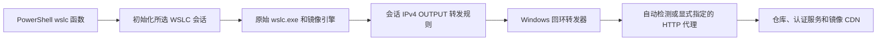

# WSLC Local Proxy

让 PowerShell 中的 `wslc pull` 通过 Windows 本机 HTTP 代理拉取镜像。代理地址可以自动检测，也可以通过参数指定。

这是针对 **WSLC 3.0.3** 实测的兼容方案。镜像由原来的 WSLC 引擎下载，不经过 Docker Desktop，也不需要导出、导入镜像。PowerShell 包装函数会在相关命令执行前配置会话内转发规则，原来的引擎进程和事件连接保持运行。

## 环境

- Windows，已安装支持容器功能的 WSLC；目前实测版本为 3.0.3。
- Windows PowerShell 5.1 或 PowerShell 7。
- 一个支持 **HTTP CONNECT** 的代理入口。
- 从源码构建需要 Go 1.27 或更新版本；只有 Go 标准库依赖。

## 构建和安装

```powershell
.\Build.ps1

# 自动检测代理
.\Install-WslcProxy.ps1 -Auto

# 或明确指定地址；裸 host:port 也可以
.\Install-WslcProxy.ps1 -ProxyUrl http://127.0.0.1:7890
```

安装目录默认为 `%LOCALAPPDATA%\wslc-local-proxy`。安装脚本会在 PowerShell 7 和 Windows PowerShell 5.1 的用户级 `profile.ps1` 中加入加载段，已有文件先备份到安装目录的 `backups` 文件夹。

新开的 PowerShell 会自动加载。已经打开的窗口执行一次：

```powershell
. "$env:LOCALAPPDATA\wslc-local-proxy\profile.ps1"
Get-WslcProxyConfig
wslc pull lscr.io/linuxserver/webtop:latest
```

更新已有安装时，不带 `-Auto` 或 `-ProxyUrl` 会保留已保存的配置：

```powershell
.\Build.ps1
.\Install-WslcProxy.ps1
```

本地旧版二进制不会代替新的构建结果；仓库中的安装脚本要求先生成 `dist\wslc-local-proxy.exe`。

## 代理选择顺序

| 优先级 | 来源 | 作用范围 |
| --- | --- | --- |
| 1 | `Enable-WslcProxy -ProxyUrl ...` | 当前 PowerShell 窗口的临时覆盖 |
| 2 | 安装参数或 `Set-WslcProxy` 保存的地址 | 用户配置文件 `config.json` |
| 3 | Windows 当前启用的用户级静态代理 | 读取 Internet Settings 中的 `ProxyEnable`、`ProxyServer` |
| 4 | `HTTPS_PROXY`、`HTTP_PROXY`、`ALL_PROXY` | Windows 没有启用静态代理时，按此顺序查找环境变量 |

Windows 的 `https=host:port;http=host:port` 格式优先选 `https` 条目，其次选 `http`。这里的键表示目标请求的协议，选择后的代理入口仍按 HTTP CONNECT 使用。

自动模式会在下次相关命令执行前重新读取 Windows 设置；不会把首次检测到的 `10808` 等端口固定在脚本中。没有找到可用地址时，命令会报告如何显式配置，不会悄悄选择一个默认端口。

支持 `http://host:port`、`host:port`、`http://[::1]:port`。当前不支持 SOCKS-only 入口、代理认证、HTTPS-to-proxy、PAC/WPAD 展开或 Windows 按网站绕过列表；有这些配置时，请选择可用的 HTTP CONNECT 入口并显式传入。

## 修改和查看配置

```powershell
# 保存地址，后续窗口也使用它
Set-WslcProxy -ProxyUrl http://127.0.0.1:7890

# 删除显式覆盖，重新自动检测
Set-WslcProxy -Auto

# 查看最终地址和来源
Get-WslcProxyConfig

# 临时使用另一个代理，只影响本窗口的选择
Enable-WslcProxy -ProxyUrl http://127.0.0.1:8080

# 查看会话规则计数和最近的 CONNECT 目标
Get-WslcProxyStatus

# 移除默认会话的规则，并关闭本窗口的自动初始化
Disable-WslcProxy
Enable-WslcProxy
```

`Set-WslcProxy` 保存的改变在下一次 `pull/push/build/run/create` 时应用。切换上游地址会重启共享的辅助转发器，正在经它传输的连接会关闭；请在当前拉取完成后切换。引擎进程不需要重启。

## 工作方式



- Windows 辅助进程只监听 `127.0.0.1` 和 `::1`，使用动态分配的本机端口。
- 辅助进程读取 TLS ClientHello 的 SNI 或普通 HTTP 的 Host，以确定目标域名，向选中的代理发送 CONNECT，然后转发原始字节。
- TLS 不在辅助进程中终止，不生成替代证书。服务器证书仍由原客户端校验。
- 会话结束后，Linux 规则自动消失；下次相关命令会重建。进程 PID、上游地址、监听端口和日志位于安装目录的 `state` 文件夹。
- `wslc image pull`、`wslc container run` 等别名及显式 `--session` 会传递给原程序。

## 范围和限制

- 规则覆盖所选 WSLC 虚拟机发起的公共 IPv4 TCP `80/443` 连接，未按进程区分，因此范围比镜像引擎本身更大。
- 私有、回环、链路本地和组播地址保持原路由。自定义仓库端口不在此方案覆盖范围。
- 公共 IPv6 HTTP/HTTPS 连接被快速拒绝，让双栈镜像引擎回退 IPv4；这是该版本 IPv6 回环验证失败后的处理方式。IPv6-only 仓库不支持。
- 未修改容器流量经过的 `FORWARD/PREROUTING` 链。使用宿主网络命名空间的程序仍受 OUTPUT 规则影响。
- HTTPS 需要可见 SNI；缺失或加密 SNI 不支持。
- `wslc.exe`、CMD、SDK 调用和 `PowerShell -NoProfile` 不会触发自动初始化。已经初始化的会话仍使用其现有规则。
- 管理员和普通用户的 WSLC 会话独立。改变其中一个会话的规则不会自动改变其他会话。
- 这是依赖当前 WSLC 网络实现的兼容方案，升级 WSL 网络实现后需要重新验证。

## 卸载

关闭其他正在使用此方案的 PowerShell 窗口；对于额外的 WSLC 会话，先清理其规则或终止已空闲的会话。然后执行：

```powershell
.\Uninstall-WslcProxy.ps1
```

卸载脚本清理默认会话的规则、移除两个用户 profile 中本项目的加载段，并停止本安装的辅助进程。包文件、配置、日志和 profile 备份保留，便于检查或重新安装。其他已打开窗口中的旧函数需要通过关闭窗口清除。

`-SkipSessionCleanup` 只用于已清理或终止相关会话的情况；否则会话可能仍保留指向已停止转发器的规则。

## 开发和验证

```powershell
go test ./...
go vet ./...
.\Build.ps1
.\tests\Test-Configuration.ps1
.\tests\Test-Installation.ps1
```

Go 测试使用本地测试服务器，覆盖代理地址解析、HTTP 原始字节保留、TLS 数据转发以及可信/不可信证书校验。PowerShell 测试覆盖配置优先级、手动/自动切换、配置持久化、含空格路径、重复安装、代理改变后的辅助进程重启、profile 内容保留和卸载。安装测试需要本机存在 `wslc.exe`，但使用临时安装目录和临时 profile，不修改真实用户配置，也不配置真实 WSLC 会话。

构建结果、运行日志、本机配置和状态文件均由 `.gitignore` 排除。
